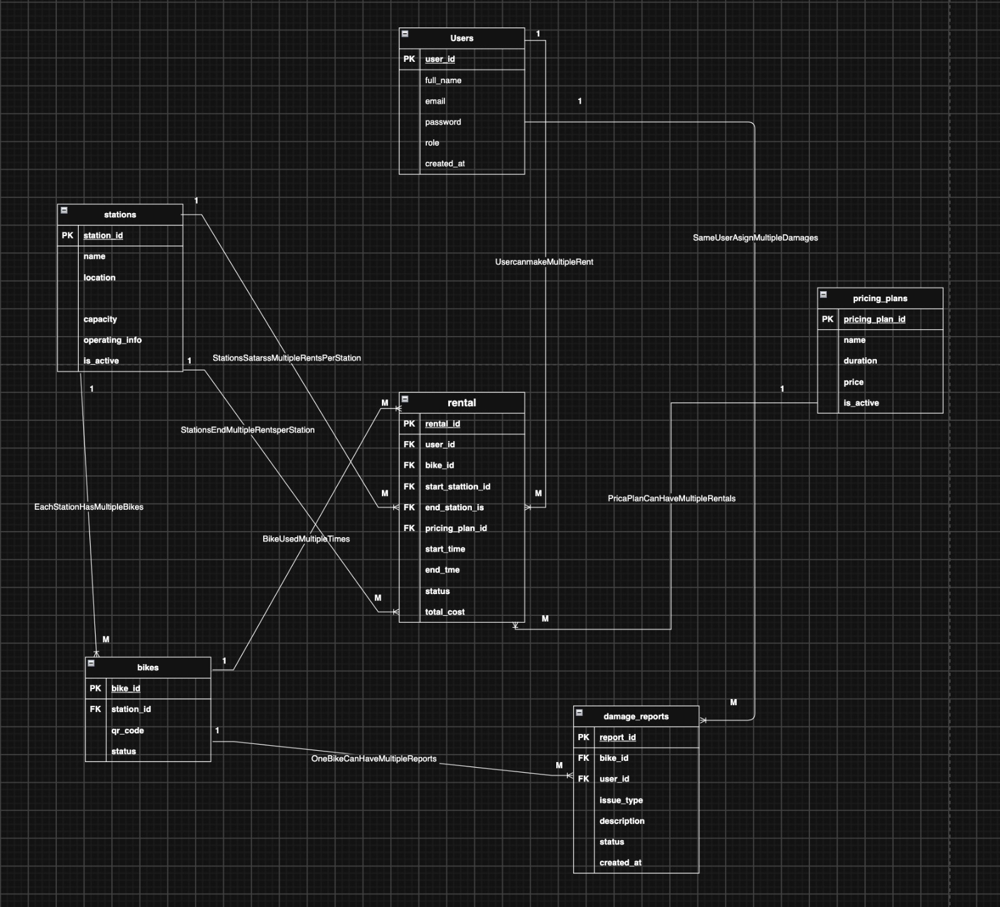

# Smart Bike Rental App

A simple bike rental system where riders can find a station, rent a bike by scanning its QR code, return it at any station, and report damage. Admins and the bike company manage stations, bikes, and pricing plans.

**GIU Software Engineering — Milestone 2 (Database Design)**

This repository contains the PostgreSQL database design for the Must-have user stories from Milestone 1: the schema, sample seed data, and the ERD.

---

## Team

| Name | Student ID | Role |
| ---- | ---------- | ---- |
| _TBD_ | _TBD_ | _TBD_ |
| _TBD_ | _TBD_ | _TBD_ |
| _TBD_ | _TBD_ | _TBD_ |
| _TBD_ | _TBD_ | _TBD_ |

---

## Project Scope

Only the **Must-have** user stories from Milestone 1 are covered:

- User accounts with three roles: `rider`, `admin`, `company`
- Docking stations with location, capacity, and operating information
- Bikes identified by a unique QR code, with a status
- Renting and returning bikes (start/end station, start/end time, cost)
- Pricing plans (hourly, daily, weekly)
- Damage reporting for bikes

Out of scope: reservations, payment gateways, notifications, AI features, and any backend, API, or frontend code.

---

## Repository Structure

```text
.
├── README.md
├── docs/
│   ├── erd.drawio          (editable ERD, to be added)
│   └── erd.jpeg            (ERD image)
└── schema/
    ├── 01_create_tables.sql
    └── 03_seed_data.sql
```

---

## Database Tables

The database has exactly **six** tables.

| Table | Purpose | Key columns |
| ----- | ------- | ----------- |
| `users` | All accounts: riders, admins, and the company. | `user_id` (PK), `email` (unique), `role` (`rider` / `admin` / `company`) |
| `stations` | Docking stations where bikes are picked up and returned. | `station_id` (PK), `name` (unique), `capacity` (> 0), `is_active` |
| `bikes` | Each physical bike. | `bike_id` (PK), `station_id` (FK, NULL while rented), `qr_code` (unique), `status` (`available` / `rented` / `maintenance`) |
| `rentals` | One row per rental, from start to return. | `rental_id` (PK), `user_id`, `bike_id`, `start_station_id`, `end_station_id`, `pricing_plan_id` (FKs), `status` (`active` / `completed` / `cancelled`), `total_cost` |
| `pricing_plans` | Available price plans. | `pricing_plan_id` (PK), `name` (unique), `duration` (`INTERVAL`), `price` (≥ 0), `is_active` |
| `damage_reports` | Problems reported by users about a bike. | `report_id` (PK), `bike_id`, `user_id` (FKs), `issue_type`, `status` (`open` / `in_progress` / `resolved`) |

Main rules enforced by the schema:

- A **rented** bike has no station (`station_id IS NULL`).
- An **active** rental has no end time, end station, or cost yet.
- A **completed** rental must have an end time, end station, and cost.
- `end_time` must be after `start_time`.
- A bike can be in at most **one active rental** at a time (partial unique index).
- Records referenced by rentals (users, bikes, stations, pricing plans) cannot be deleted (`ON DELETE RESTRICT`), so rental history is kept. Stations and plans are retired with `is_active = FALSE` instead.

The design is in Third Normal Form (3NF): every non-key column depends only on its table's primary key, and there is no duplicated data between tables (for example, prices live only in `pricing_plans`, station details only in `stations`).

---

## Relationships

| # | Relationship | Foreign key | Nullable | ON DELETE |
| - | ------------ | ----------- | -------- | --------- |
| 1 | `users` (1) → `rentals` (N) | `rentals.user_id` | No | RESTRICT |
| 2 | `bikes` (1) → `rentals` (N) | `rentals.bike_id` | No | RESTRICT |
| 3 | `stations` (1) → `bikes` (N) | `bikes.station_id` | Yes (bike is out on a rental) | RESTRICT |
| 4 | `stations` (1) → `rentals` (N), start | `rentals.start_station_id` | No | RESTRICT |
| 5 | `stations` (1) → `rentals` (N), end | `rentals.end_station_id` | Yes (rental still active) | RESTRICT |
| 6 | `pricing_plans` (1) → `rentals` (N) | `rentals.pricing_plan_id` | No | RESTRICT |
| 7 | `users` (1) → `damage_reports` (N) | `damage_reports.user_id` | No | RESTRICT |
| 8 | `bikes` (1) → `damage_reports` (N) | `damage_reports.bike_id` | No | CASCADE |

The reason for each `ON DELETE` choice is written as a comment next to the foreign key in [`schema/01_create_tables.sql`](schema/01_create_tables.sql).

---

## Entity-to-User-Story Traceability

> **TODO:** Replace each `US-??` with the actual Must-have story IDs from the Milestone 1 document.

| Table | Must-have user story ID(s) | What the stories need |
| ----- | -------------------------- | --------------------- |
| `users` | US-?? | Register / log in; role-based access for rider, admin, company |
| `stations` | US-?? | View stations and their availability; admin manages stations |
| `bikes` | US-?? | Scan a bike's QR code; see bike status; admin/company manages bikes |
| `rentals` | US-?? | Start a rental, end a rental at a station, view rental cost/history |
| `pricing_plans` | US-?? | View and choose hourly / daily / weekly plans; admin manages plans |
| `damage_reports` | US-?? | Rider reports bike damage; admin/company tracks and resolves reports |

---

## ERD

[Editable ERD](docs/erd.drawio)



---

## Requirements

- **PostgreSQL** 14 or newer (tested with PostgreSQL 18)
- **pgAdmin 4**

No extensions or other dependencies are needed.

---

## Setup with pgAdmin 4

1. Open **pgAdmin 4** and connect to your local PostgreSQL server.
2. In the browser tree, right-click **Databases** → **Create** → **Database...**
3. Name it `smart_bike_rental` and click **Save**.
4. Select the new `smart_bike_rental` database, then open **Tools** → **Query Tool**.

## Running the SQL Scripts

Run the scripts **in numeric order** in the Query Tool:

1. Click **Open File** (folder icon), choose `schema/01_create_tables.sql`, then press **Execute** (F5).
2. Open `schema/03_seed_data.sql` and press **Execute** (F5).

Both scripts should finish without errors. The first script drops and recreates the six tables, so running it again **deletes all existing data**.

Alternatively, using `psql`:

```bash
createdb smart_bike_rental
psql -d smart_bike_rental -f schema/01_create_tables.sql
psql -d smart_bike_rental -f schema/03_seed_data.sql
```

---

## Verification

Run these queries in the Query Tool after both scripts.

**1. The six tables exist:**

```sql
SELECT table_name
FROM information_schema.tables
WHERE table_schema = 'public'
ORDER BY table_name;
```

Expected: `bikes`, `damage_reports`, `pricing_plans`, `rentals`, `stations`, `users`.

**2. Sample data was inserted:**

```sql
SELECT 'users' AS table_name, COUNT(*) FROM users
UNION ALL SELECT 'stations', COUNT(*) FROM stations
UNION ALL SELECT 'bikes', COUNT(*) FROM bikes
UNION ALL SELECT 'pricing_plans', COUNT(*) FROM pricing_plans
UNION ALL SELECT 'rentals', COUNT(*) FROM rentals
UNION ALL SELECT 'damage_reports', COUNT(*) FROM damage_reports;
```

Expected: users 5, stations 3, bikes 6, pricing_plans 3, rentals 5, damage_reports 3.

**3. Relationships work (rentals with user, bike, stations, and plan):**

```sql
SELECT r.rental_id, u.full_name, b.qr_code,
       s1.name AS start_station, s2.name AS end_station,
       p.name AS plan, r.status, r.total_cost
FROM rentals r
JOIN users u          ON u.user_id = r.user_id
JOIN bikes b          ON b.bike_id = r.bike_id
JOIN stations s1      ON s1.station_id = r.start_station_id
LEFT JOIN stations s2 ON s2.station_id = r.end_station_id
JOIN pricing_plans p  ON p.pricing_plan_id = r.pricing_plan_id
ORDER BY r.rental_id;
```

**4. Constraints reject bad data (each statement should fail with an error):**

```sql
-- Foreign key: user 999 does not exist
INSERT INTO rentals (user_id, bike_id, start_station_id, pricing_plan_id) VALUES (999, 1, 1, 1);

-- UNIQUE: duplicate email
INSERT INTO users (full_name, email, password_hash) VALUES ('Test', 'ahmed.hassan@example.com', 'x');

-- CHECK: invalid role
INSERT INTO users (full_name, email, password_hash, role) VALUES ('Test', 'test@example.com', 'x', 'superuser');
```
